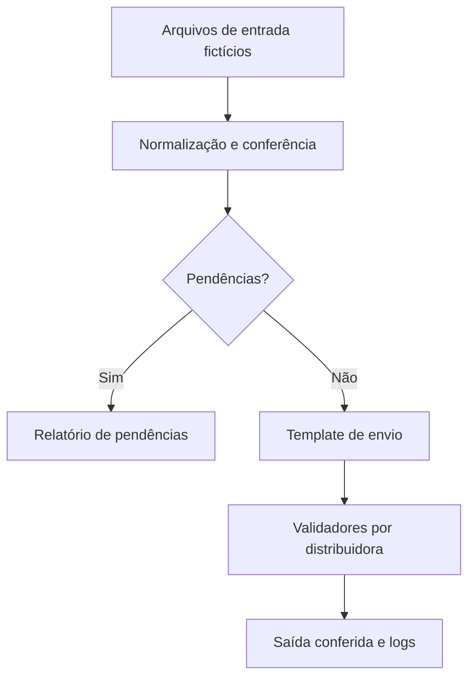
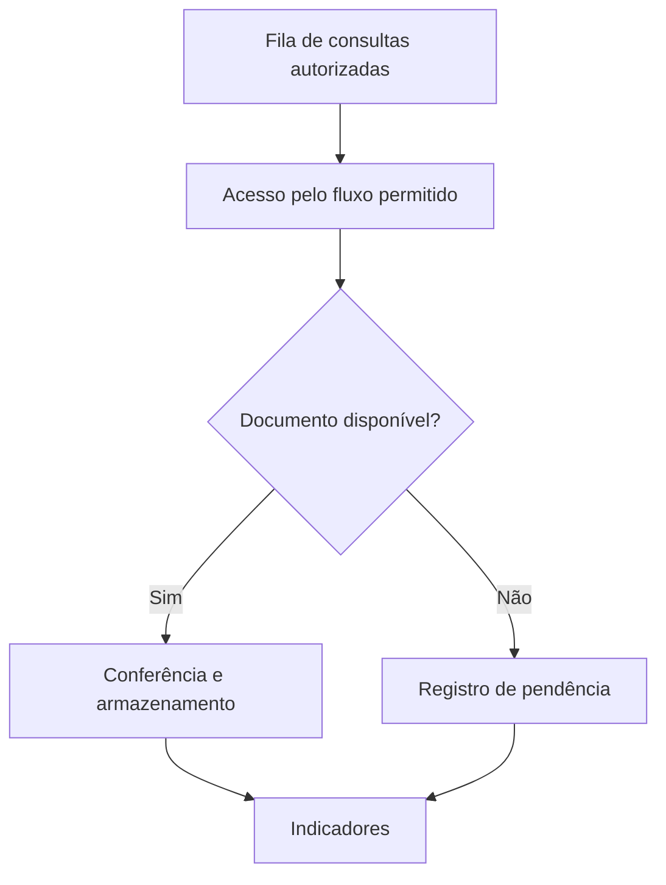

# Arquitetura dos cases (visão demonstrativa)

Os diagramas descrevem conceitos de projeto, **não a infraestrutura interna de uma empresa**.

## Rateio

**Decisões:** separar entrada e saída, validar competência e campos obrigatórios, registrar status por etapa e evitar publicar arquivos incompletos.

## Captura

Os exemplos respeitam autenticação, CAPTCHA e controles de acesso; não documentam evasão dessas proteções.

## BI

Bases de referência e resultados passam por normalização, deduplicação e conciliação antes de gerar indicadores de total, atendido, faltante e pendente.

## Próximos passos técnicos

- Testes automatizados com dados sintéticos.
- Medição de duração por etapa.
- Verificação de integridade dos resultados.
- Pipeline de qualidade com GitHub Actions.

São **melhorias planejadas**, não funcionalidades já comprovadas nos exemplos atuais.
